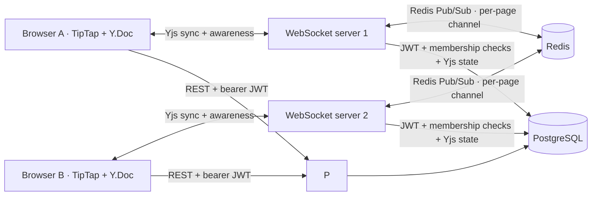

# Architecture

## Edit and presence flow

1. The browser opens a page with a Yjs document named by the page ID. TipTap Collaboration binds its ProseMirror document to that Y.Doc.
2. The Yjs WebSocket server verifies the signed JWT and checks that the user owns the page workspace or has `edit`/`owner` membership.
3. Yjs sync messages carry CRDT updates. Concurrent insertions/deletions converge without a last-write-wins overwrite. Awareness messages carry ephemeral cursor and user metadata.
4. Each realtime process publishes document updates and awareness changes to `collabspace:doc:<pageId>`. Other processes apply remote messages to their local Y.Doc and relay them to their connected browsers. Sender IDs prevent a process from reapplying its own published messages.
5. A debounced full Yjs state is upserted into PostgreSQL. On first room access after a process restart, the saved state is loaded before clients connect.

Comments, membership, workspace metadata, page titles, and snapshot metadata are normal relational records. Awareness state is ephemeral and is not persisted.

## Conflict resolution notes

Yjs shared types assign unique item IDs to inserted content and record causal dependencies. Independent concurrent inserts can coexist; deterministic ordering produces the same visible result on every replica. Deletions are represented as CRDT tombstones. Clients exchange state vectors to request only missing structs. Awareness is intentionally separate from document state because cursors and online status expire with a connection.

## Scaling / operational notes

Run multiple `backend/realtime.cjs` processes with the same `REDIS_URL`, `DATABASE_URL`, and `JWT_SECRET`. A load balancer must allow WebSocket upgrades. Redis Pub/Sub is transient; PostgreSQL Yjs-state upserts provide restart recovery. Redis failures leave clients connected to their local process, but cross-process changes stop propagating until Redis recovers. Production should use Redis TLS/ACLs, database backups, metrics, backpressure limits, and rate limits.

The demo seeds one Design Studio workspace plus three pages for each new account. Initial sample copy is supplied by the client for the welcome page; edits then become the persisted Yjs document.
